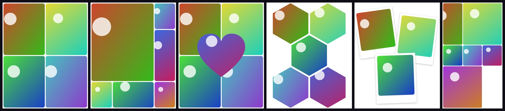

# Collage Studio

A watermark-free Instagram collage maker for iOS and Android (Expo / React Native).



*Real exports from the app's rendering engine (`npm run render:samples`), using generated test photos.*

## Features

- **196 templates** in 9 categories: Grid, 2–6+ photo layouts, Shapes (heart, circle, hexagon honeycomb, star, diamond, arch, pill), Freestyle (polaroids, scatter, film strip, photo booth, inset) and Stories.
- **Instagram aspect ratios:** 4:5 portrait, 1:1 square, 9:16 story/reel, 3:4 and 1.91:1 landscape.
- **Editing:** tap a cell to add a photo, or fill every empty cell in one go. Drag to reposition, pinch to zoom. Swap, replace, remove and reset photos. Adjust spacing, outer border and corner rounding, choose from 24 background colors, and toggle frame shadows.
- **High-quality export, no watermark:**
  - Choose 1080, 2160 (default), 3240 or 4320 px wide.
  - The export is rendered from your **original full-resolution photos**, not from the screen preview.
  - Downscaling uses trilinear mipmapped sampling, so fine detail stays clean and sharp.
  - Save as JPEG at quality 100 or as lossless PNG.
  - The app warns you if a photo would have to be enlarged at the size you picked.
  - Photos are decoded one at a time, so even 48 MP originals stay within phone memory.
- **Saved to its own folder:** finished collages go to a **"Collage Studio"** album and never mix with your camera photos.
  - Android: the `Pictures/Collage Studio` folder.
  - iOS: Photos → Albums → Collage Studio.
- **Post to Instagram:** one tap after saving.

## Instagram connection: how it works and why

The app does **not** log in to Instagram, and it never asks for your Instagram password or stores a token.

Instagram's official publishing API (the Graph API Content Publishing API) isn't safe or practical to use from a phone app:

- It only works with Business or Creator accounts.
- It needs a Meta/Facebook app secret, which has to live on a server. Putting it inside a phone app would leak it.
- Every image must first be uploaded to a public web URL.
- The app has to pass Meta's app review.

Instead, the saved collage goes to the real Instagram app through the operating system:

| Platform | What "Post to Instagram" does |
| --- | --- |
| iOS | Opens Instagram's composer with the collage already selected, using Instagram's official `instagram://library?LocalIdentifier=` link. |
| Android | Opens the system share sheet. Instagram Feed, Story, Reels and Direct appear there when Instagram is installed. |

You stay signed in to Instagram itself, and this app never handles your credentials.

## Running it

Requirements: Node 20+ and the Expo tooling (`npx expo`).

```bash
npm install
```

The app uses native modules (Skia and full photo-library access), so run it as a **development build** rather than in Expo Go:

```bash
# Android device or emulator (needs Android Studio / SDK)
npx expo run:android

# iOS (needs a Mac with Xcode)
npx expo run:ios
```

You can also build in the cloud without a local toolchain, using [EAS](https://docs.expo.dev/eas/):

```bash
npx eas-cli@latest build --profile development --platform android
```

### Browser demo

The same app also runs in a web browser, using Skia's WebAssembly build. In a browser, "Save" downloads the file, because there is no photo library to save into.

```bash
npm run web         # dev server
npm run build:web   # static build in dist-web/
```

### Useful scripts

| Command | What it does |
| --- | --- |
| `npm run typecheck` | Runs the TypeScript checks. |
| `npm run render:samples` | Renders sample collages to `samples/` with the real export pipeline (Skia via CanvasKit in Node). No phone needed. Pass template ids to render specific ones. |

## Project layout

```
App.tsx                    screen switching (template gallery ⇄ editor)
src/templates.ts           all templates: grids, mosaics, shapes, freestyle, stories
src/render.ts              Skia drawing shared by preview and export, plus full-res export
src/share.ts               save to the "Collage Studio" album, hand-off to Instagram
src/screens/Gallery.tsx    template browser with categories and aspect ratios
src/screens/Editor.tsx     canvas, gestures, layout/ratio/spacing/color tools
src/screens/ExportSheet.tsx export size and format, save, Post to Instagram
scripts/                   headless render harness (Node)
```

Templates are plain data in normalized 0–1 coordinates. To add one, push a new entry in `src/templates.ts`. The `H()` and `V()` helpers build split layouts, for example `H([2, 1], L, V(null, L, L))` makes one large photo next to two stacked ones.

## Notes and limitations

- Instagram recompresses everything it receives. Exporting at 2160 px (2×) gives its resizer the most detail to work with. Use 1080 px if you want an exact pixel match with Instagram's feed.
- On iOS, a saved collage also appears in the "Recents" view, as every photo does. It still sits in its own "Collage Studio" album. If you grant only *limited* photo access, iOS may hide the album, and the app then falls back to a normal save.
- The browser version is a demo. Saving into a dedicated album and posting to Instagram need the phone app.
