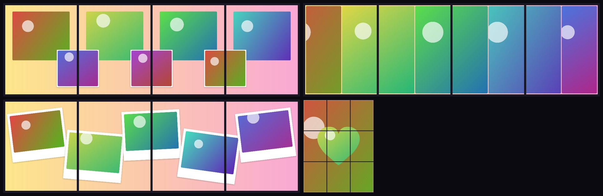
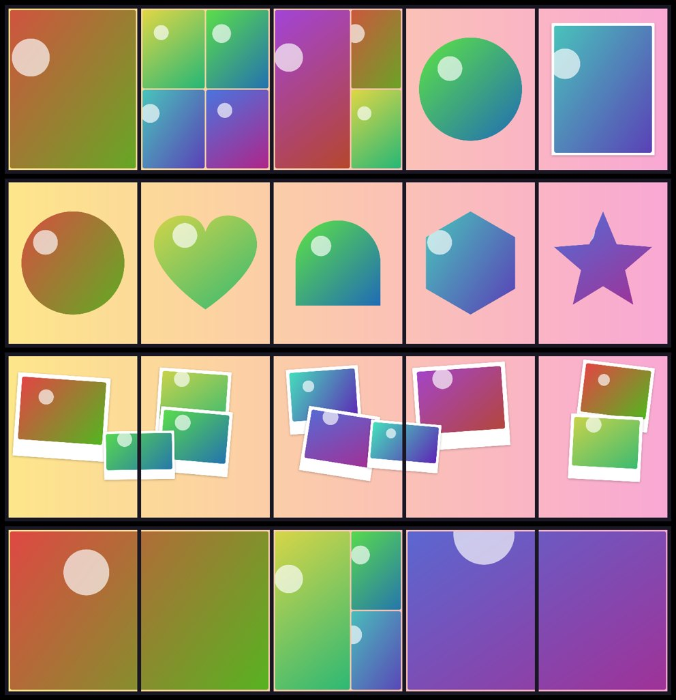

# Collage Studio

A watermark-free Instagram collage maker for iOS and Android (Expo / React Native).


*Real exports from the app's rendering engine (`npm run render:samples`), using generated test photos.*

## Features

Four kinds of post, all exported without a watermark:

| Mode | What you get | Designs |
| --- | --- | --- |
| **Single post** | One collage for the feed or Stories (4:5, 1:1, 9:16, 3:4, 1.91:1). | 196 layouts: grids, mosaics, shapes, polaroids, stories |
| **Seamless carousel** | One continuous design across **2–20 slides** (Instagram's carousel limit). Photos and gradients flow across slide edges as you swipe. | Panorama, seam bridges, cascade, polaroid trail, bubble wave, film roll, brick wall… (12) |
| **Slide-by-slide carousel** | A different layout on every slide (cover, grid, shape, polaroid, finale…), with some photos bridging two slides so the swipe stays connected. | Story mix, Rhythm 1·2·3·4, Magazine, Shape tour, Spotlight series, Scrapbook, Panorama breaks, Dynamic duo, Cover/grid/finale, Wave, Mosaic + bridges, Breathing room, Film diary, Editorial split (14) |
| **Split-screen carousel** | Every slide split into panels: side by side, top and bottom, diagonal, zigzag, triptych. "Across the seam" cuts each photo in half between two slides. | 10 |
| **Panoramic profile grid** | One picture split into 3, 6, 9 or 12 posts that line up on your profile. Tiles export at **3:4 (1080 × 1440)**, the shape the profile grid shows, and are numbered in **posting order**. | 10 |



Slide-by-slide designs (each row is one carousel):



**Design**

The interface follows Apple's Human Interface Guidelines:
- **Colors and type:** iOS system colors in light and dark, and the San Francisco type scale (Inter on non-Apple browsers).
- **Controls:** segmented controls, grouped inset lists, iOS steppers, switches and sliders, a page control for slides, sheets with Cancel/Done, and haptic feedback.
- **Appearance:** the template browser follows the system setting. The editor is always dark, like editing in Photos, so the colors in your collage read accurately.


**Editor**
- Carousels open in a swipe view (one slide plus a peek of the next), with numbered slides and dashed seams, or you can switch to see the whole strip at once.
- Tap a cell to add a photo, or fill every empty cell at once. Drag to reposition, pinch or use the buttons to zoom, and swap, replace or remove photos.
- Change the slide or row count at any time without losing your photos.
- Spacing, border and corner sliders. Solid colors, or gradients that run continuously across all slides, with a choice of direction.
- Undo and redo for every change.

**Export**
- Choose 1080 (Instagram's stored width), 2160 (default), 3240 or 4320 px per image, as JPEG at quality 100 or lossless PNG.
- Each image is rendered from your **original full-resolution photos**, with trilinear sampling. Photos are decoded once and released after the last slide that needs them, so 20-slide carousels stay within phone memory.
- The app warns you when a photo would have to be enlarged.
- **Saved to its own folder:** a "Collage Studio" album (Android: `Pictures/Collage Studio`), never mixed with your camera photos.
  - Carousel slides are saved in swipe order.
  - Grid tiles are saved in posting order: the bottom-right tile is posted first, because the newest post shows top-left.

## Instagram connection: how it works and why

The app does **not** log in to Instagram, and it never asks for your Instagram password or stores a token.

Instagram's official publishing API (the Graph API Content Publishing API) isn't safe or practical to use from a phone app:

- It only works with Business or Creator accounts.
- It needs a Meta/Facebook app secret, which has to live on a server. Putting it inside a phone app would leak it.
- Every image must first be uploaded to a public web URL.
- The app has to pass Meta's app review.

Instead, the saved collage goes to the real Instagram app through the operating system:

| Platform | What "Post to Instagram" does |
| --- | --- |
| iOS | Opens Instagram's composer with the collage already selected, using Instagram's official `instagram://library?LocalIdentifier=` link. |
| Android | Opens the system share sheet for a single image, or opens Instagram for a carousel or grid. |

For carousels you choose "Select multiple" in Instagram and tap the slides in order from the Collage Studio album. Instagram's own deep link can only preselect one image.

You stay signed in to Instagram itself, and this app never handles your credentials.

## Running it

Requirements: Node 20+ and the Expo tooling (`npx expo`).

```bash
npm install
```

The app uses native modules (Skia and full photo-library access), so run it as a **development build** rather than in Expo Go:

```bash
# Android device or emulator (needs Android Studio / SDK)
npx expo run:android

# iOS (needs a Mac with Xcode)
npx expo run:ios
```

You can also build in the cloud without a local toolchain, using [EAS](https://docs.expo.dev/eas/):

```bash
npx eas-cli@latest build --profile development --platform android
```

### Install on iPhone (no App Store needed)

The web version is published automatically to **https://darrie-andrei-dizon.github.io/collage-studio/** on every push to `main` (see `.github/workflows/pages.yml`).

1. Open the link in **Safari** on your iPhone.
2. Tap **Share** → **Add to Home Screen** → **Add**.
3. Open **Collage** from your home screen. It runs full screen and works offline after the first visit.

When you export, tap **Save to Photos** and choose **Save Image(s)**, or pick Instagram from the share sheet. Compared with the native app:
- **No album:** images go to Recents. A web app can't create its own "Collage Studio" album.
- **No haptics:** taps don't vibrate.
- **Smaller maximum size:** the largest export is 3240 px, because Safari limits a page's memory.

### Browser demo

The same app also runs in a web browser, using Skia's WebAssembly build. In a browser, "Save" downloads the image, or one ZIP for a carousel or grid, because there is no photo library to save into.

```bash
npm run web         # dev server
npm run build:web   # static build in dist-web/
```

### Useful scripts

| Command | What it does |
| --- | --- |
| `npm run typecheck` | Runs the TypeScript checks. |
| `npm run render:samples` | Renders sample collages to `samples/` with the real export pipeline (Skia via CanvasKit in Node). No phone needed. Pass template ids to render specific ones. |

## Project layout

```
App.tsx                    screen switching (home ⇄ editor)
src/templates.ts           single-post templates and the layout helpers (H, V, L)
src/multi.ts               seamless carousel, split-screen and profile-grid templates
src/stories.ts             slide-by-slide carousels: a scene library and 14 designs
src/project.ts             modes, ratios and Instagram limits
src/render.ts              Skia drawing shared by preview and export; per-slide full-res export
src/share.ts               save to the "Collage Studio" album in order, hand-off to Instagram
src/icons.tsx              line icons drawn with Skia (no icon font needed)
src/zip.ts                 ZIP writer for multi-image downloads on web
src/screens/Home.tsx       large title, mode segmented control, grouped settings, templates
src/screens/Editor.tsx     swipe/overview canvas, gestures, undo/redo, tool dock
src/screens/ExportSheet.tsx size and format, slide previews, posting order, Instagram
scripts/                   headless render harness (Node)
```

Templates are plain data in normalized 0–1 coordinates. To add one, push a new entry in `src/templates.ts`. The `H()` and `V()` helpers build split layouts, for example `H([2, 1], L, V(null, L, L))` makes one large photo next to two stacked ones.

## Notes and limitations

- Instagram recompresses everything it receives. Exporting at 2160 px (2×) gives its resizer the most detail to work with. Use 1080 px if you want an exact pixel match with Instagram's feed.
- On iOS, a saved collage also appears in the "Recents" view, as every photo does. It still sits in its own "Collage Studio" album. If you grant only *limited* photo access, iOS may hide the album, and the app then falls back to a normal save.
- The browser version is a demo. Saving into a dedicated album and posting to Instagram need the phone app.
